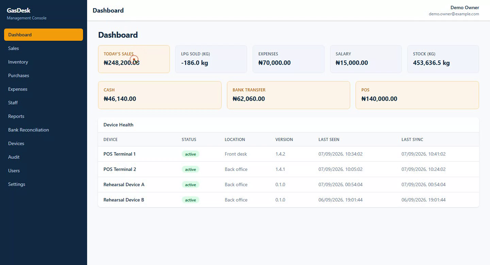
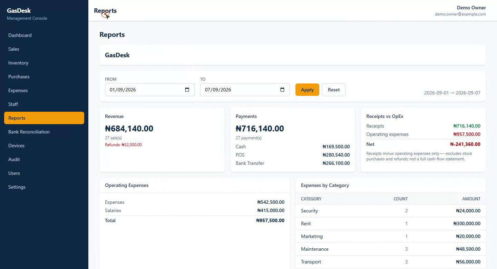
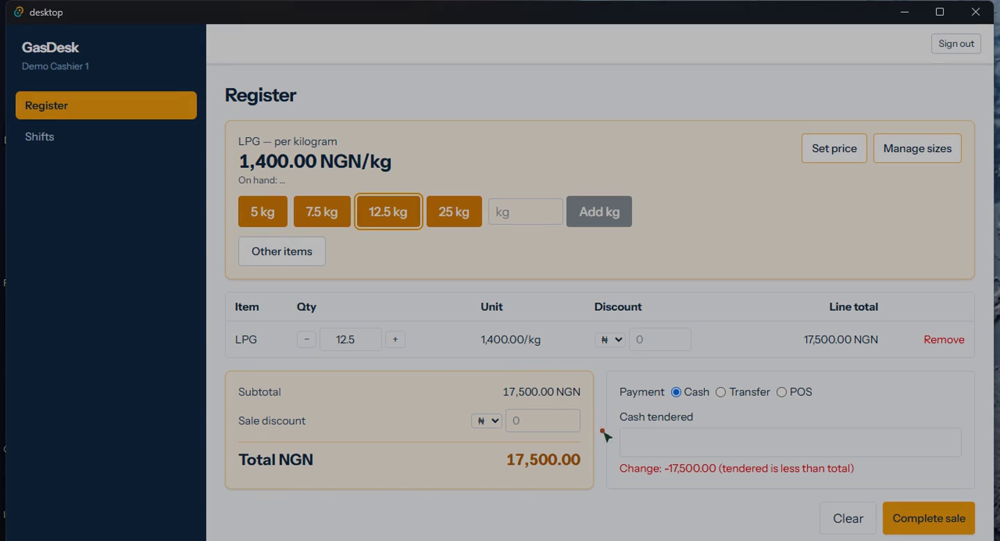
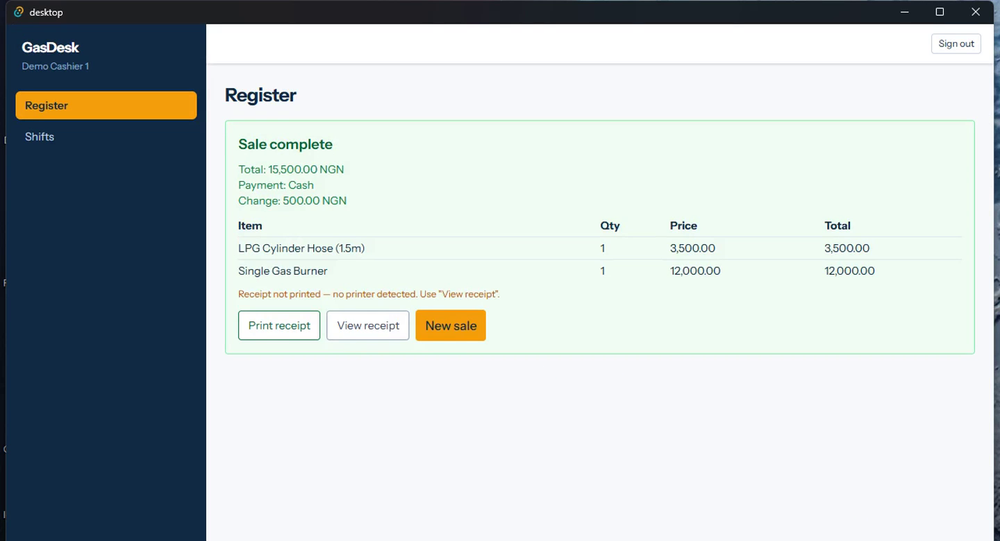

# GasDesk — LPG Plant & Retail Management System

> An offline-first point-of-sale and back-office platform for LPG (cooking gas) plants: cylinder sales, refills, deliveries, cashier shifts, inventory in kilograms, accounting and bank-statement reconciliation — designed to keep selling when the internet does not.

| | |
|---|---|
| **Role** | Solo — product design, architecture, backend, desktop app, cloud admin |
| **Timeline** | 2026 — active development |
| **Stack** | Laravel 12 · PHP 8.4 · PostgreSQL 16 · Redis 7 · Tauri 2 · Rust · Vue 3 · TypeScript · SQLite |
| **Scale** | 331 commits · 10 delivery phases shipped · cloud + desktop + web admin surfaces |

> **The source code for this project is private.** This repository is a technical case study: what the system does, how it is built, and real screenshots from the running application. I am happy to walk through the codebase in an interview or on request.

---

## The problem

A gas plant sells a product that is measured in kilograms, priced per kilogram, and dispensed into customer cylinders of different sizes. The business day is a stream of small cash and transfer transactions taken at a counter, often on a laptop with a flaky mobile connection.

Most POS software assumes connectivity. When the connection drops, the business stops taking money — which is unacceptable for a retail counter. GasDesk was designed around the opposite assumption:

- **The register never needs the internet.** Sales, stock movements and shift closes are written locally and queued.
- **The cloud is a mirror, not a gatekeeper.** Sync is bidirectional, idempotent and replay-safe.
- **Accounting must reconcile with reality.** Bank statements (PDF) are imported and matched against transfer sales, expenses and payroll.

---

## Product tour

### Cloud administration — the owner's view



Daily sales, kilograms dispensed, expenses, payroll cost, current stock, and a split by payment channel (cash / bank transfer / POS). The device-health panel below shows every terminal, its app version, last-seen time and last successful sync — which is how you operate a fleet of offline registers.



Period reports: revenue versus receipts, refunds, operating expenses by category, and a net figure explicitly labelled as *receipts minus operating expenses* rather than pretending to be a cash-flow statement.

### Desktop register — the cashier's view



A keyboard-first register built for speed at the counter: LPG is sold per kilogram with preset cylinder sizes (5 kg, 7.5 kg, 12.5 kg, 25 kg) plus arbitrary weights, alongside other items such as hoses and burners. Payment is cash, transfer or POS terminal, with change calculation and per-line discounts.



A completed sale shows the receipt, offers a retry when no thermal printer is attached, and returns to a new sale without leaving the screen. The sync indicator in the bottom-left is always visible; the cashier never has to think about it.

---

## What is in the system

### Point of sale and cashier operations
- Keyboard-driven register with a product catalogue, arbitrary-weight LPG sales, preset cylinder sizes, line and sale discounts
- Cash / bank transfer / POS-terminal payment methods, change calculation, one-shot sale reversal
- Configurable stock gate (`inventory.allow_negative_stock`) instead of hard-blocking a sale mid-transaction
- Cashier shifts: register open/close, cash movements, shift reports
- Receipt generation with thermal-printer fallback ("Receipt not printed — no printer detected")
- Customers and agent accounts, sales history

### Inventory
- Catalogue of products, categories, units and suppliers
- **Movement-based stock balances** rather than a mutable "quantity" column — every change is a movement with a reason
- Goods-received notes (GRN), adjustments with a configurable approval threshold, physical-count reconciliation
- Bidirectional sync of stock with conflict parking

### Accounting and reconciliation
- Bank accounts as masked master data; accounting dashboard and profit summary
- Five financial reports (sales, payments, expenses, salary) plus bank charges
- **Bank statement PDF import**: extraction review, automatic matching against transfer sales, expenses and payroll settlements with confidence scores, bank-charge categorisation, discrepancy and variance reporting, marked-reconciled snapshots
- Reconciliation outcomes sync to the cloud as web-copy tables — deliberately **without** sensitive bank data

### People and operations
- Staff, job titles and salaries; expenses with inline attachments; payroll records
- Role and permission matrix enforced across both desktop and cloud surfaces
- Audit log, device management, platform administration

### Commercial model
- Multi-company (SaaS) with per-company plans, pricing and payment configuration
- Multi-branch operation with centralised reporting
- Platform admin surface for company lifecycle, data reset and device oversight

---

## Architecture

```
┌──────────────────────────────┐          ┌───────────────────────────────┐
│  DESKTOP (Tauri 2)           │          │  CLOUD (Laravel 12)           │
│                              │          │                               │
│  Vue 3 + TypeScript UI       │          │  Inertia + Vue 3 admin        │
│           │                  │          │  REST API (/api/sync/*)       │
│           ▼                  │  HTTPS   │           │                   │
│  Rust core                   │◄────────►│  PostgreSQL 16                │
│   ├─ SQLite (WAL, single     │  push/   │   ├─ append-only sync ledger  │
│   │   writer)                │  pull    │   │   (global cursor)         │
│   ├─ outbox (durable queue)  │          │   ├─ domain tables            │
│   ├─ sync engine (15s loop)  │          │   └─ device registry          │
│   ├─ apply / conflict park   │          │  Redis 7 (queues, cache)      │
│   └─ hardware adapter seam   │          │                               │
└──────────────────────────────┘          └───────────────────────────────┘
```

### The sync engine

The interesting engineering in this project is not the CRUD — it is making two writes-first databases converge without losing money.

**Cloud side**
- An **append-only event ledger** with a globally monotonic cursor. Events are never mutated or deleted; the cursor is the contract for "what has this device seen".
- `POST /api/sync/push` is **idempotent**: replayed payloads return `duplicate` per operation and never create a second ledger row.
- `POST /api/sync/pull` is **cursor-gated** and paginated, so a device that has been offline for a week catches up in bounded batches.
- Devices are first-class records: register, activate, revoke, require re-authentication. A revoked device gets `403 DEVICE_REVOKED` on its next call.

**Desktop side (Rust)**
- SQLite runs in WAL mode with a single writer; the UI never talks to the database directly.
- A durable `sync_operations` outbox sits between the UI and the network. Writes commit locally and enqueue — the sale is banked before the network is involved.
- The engine pushes on a 15-second loop with exponential backoff, a circuit breaker, and **parking** of operations that fail repeatedly so one poisoned record cannot block the queue.
- Pulled events are applied through a versioned apply layer; conflicts are recorded and surfaced, not silently overwritten.
- Typed events expose sync state to the UI (`sync:status`), which is what drives the "Synced just now" pill and the device-health panel in the cloud console.

### Engineering decisions worth calling out

1. **Local-first over optimistic UI.** A sale is a committed local transaction first. The network is a background concern, not part of the checkout path.
2. **Movements over balances.** Stock quantities are derived from movements. It makes reconciliation, auditing and conflict detection tractable.
3. **Idempotency as a primitive.** Push payloads carry client-generated identifiers so retries are safe by construction, not by hope.
4. **Park, don't block.** Repeatedly failing operations are quarantined with their error, keeping the rest of the queue flowing.
5. **Sensitive data stays local.** Bank statement extraction and matching happen on the desktop; only summaries sync upward.
6. **Spec-first delivery.** Each of the 10 phases has a written design spec and an implementation plan under `docs/`, with explicit exit criteria (e.g. "kill the app mid-sync and prove no partially-applied state").

---

## Testing and quality gates

- PHPUnit feature tests for the cloud API, including duplicate-push replay tests and device revocation
- Rust unit/integration tests for the sync engine: outbox ordering, backoff, parking, apply idempotency
- Vitest for the Vue admin surface
- Manual end-to-end walkthrough scripts per phase (`docs/manual-e2e-phase*.md`) covering printer fallback, backup/restore, statement import and shift close
- A written security review and a permission matrix checked against routes

---

## Status

Shipped: foundation, sync engine, product & inventory, POS & sales, cashier operations, staff & expenses, accounting, bank reconciliation, cloud web management, hardening, multi-company, platform admin, multi-branch.

In progress: continued hardening of reconciliation edge cases and release/update flow for field devices.

---

## Why this project is representative of how I work

GasDesk is the clearest example of how I use AI-assisted development end to end: I wrote the phase specs and acceptance criteria, then used coding agents to implement against them, then verified each phase with its own exit criteria before moving on. The result is a production-shaped system — an offline-first Rust/Tauri client, a synced Laravel/Postgres backend and a web console — built solo in a few months, with the specs and plans retained in the repository as an audit trail.
